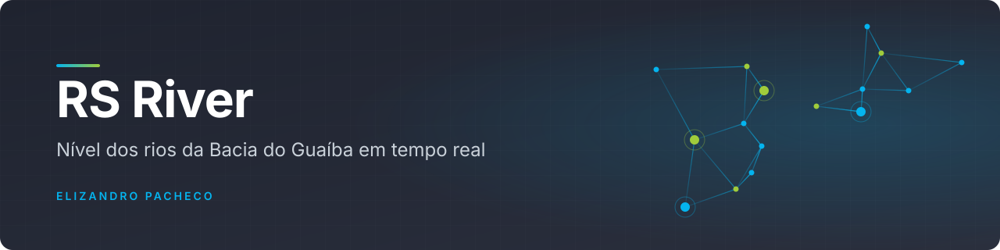
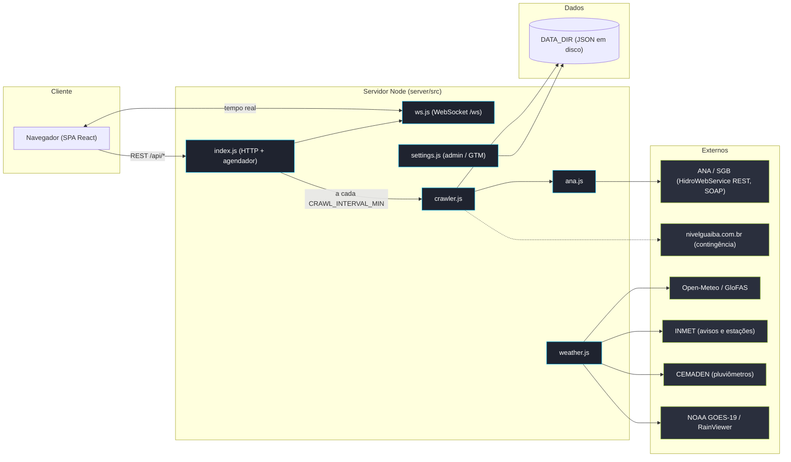

<div align="center">



<br>

**Painel de consciência situacional para resgate e população: o nível de todos os rios da Bacia do Guaíba, com cota de inundação, tendência de subida, alertas e radar, em uma única tela que se atualiza sozinha.**

[](LICENSE)
[](https://github.com/elizandropacheco/rs-river)
[](server/package.json)
[](https://github.com/elizandropacheco/rs-river/commits)
[](https://github.com/elizandropacheco/rs-river/stargazers)


[Arquitetura](#arquitetura) · [Começando](#começando) · [Uso](#uso) · [Fontes de dados](#fontes-de-dados)

</div>

---

## Sumário

- [Sobre](#sobre)
- [Destaques](#destaques)
- [Arquitetura](#arquitetura)
- [Stack](#stack)
- [Começando](#começando)
- [Uso](#uso)
- [Fontes de dados](#fontes-de-dados)
- [Estrutura do projeto](#estrutura-do-projeto)
- [Deploy](#deploy)
- [Contribuição](#contribuição)
- [Segurança](#segurança)
- [Licença](#licença)
- [Autor](#autor)

## Sobre

Em maio de 2024, a maior enchente da história do Rio Grande do Sul devastou a região metropolitana de Porto
Alegre. O bairro **Humaitá** foi um dos mais atingidos, e foi ali que nasceram os **Guerreiros do Humaitá**,
entidade humanitária de voluntários especializada em resgates, logística e distribuição de doações, que já
salvou mais de 500 animais e atua da linha de frente até a organização das ajudas por todo o Estado.

Quando um rio sobe, cada minuto conta. A diferença entre uma evacuação tranquila e um resgate de emergência
costuma estar em enxergar a subida do nível *antes* que ela vire tragédia. As informações oficiais existem,
mas estão espalhadas por várias estações, páginas e formatos.

O **RS River** é um projeto dos [Guerreiros do Humaitá](https://guerreirosdohumaita.com.br) ("O Povo pelo
Povo!") que reúne tudo isso em uma única tela, para equipes de resgate, Defesa Civil comunitária e
população: simples de abrir, rápida de ler e atualizada sozinha, para antecipar decisões e proteger vidas.

> [!WARNING]
> Este painel é uma ferramenta de apoio à decisão. **Não substitui os canais oficiais da Defesa Civil
> (telefone 199).** Em emergência, ligue **193** (Bombeiros).

## Destaques

- **14 estações** na mesma tela: Porto Alegre, Lajeado, Encantado, Muçum, Roca Sales, São Sebastião do Caí,
  Taquara, Gravataí, Bom Retiro do Sul, Cachoeira do Sul, Dona Francisca, Rio Pardo, São Leopoldo e Feliz.
- **Nível, tendência e margem**: nível atual com coluna d'água, tendência em cm/h e quantos metros faltam (ou
  já passaram) da cota de inundação, com recorde histórico e chuva em cada card.
- **Alertas visuais**: *Inundação* com brilho pulsante vermelho, *Alerta* e *Atenção* com cores próprias e
  ordenação automática por risco.
- **Mapa da bacia** sobre o contorno do RS, com as estações georreferenciadas e setas no sentido da
  correnteza até o Delta do Jacuí, o Guaíba e a Lagoa dos Patos.
- **Alertas do INMET** vigentes no RS, com severidade e cor oficiais, casados com as cidades monitoradas.
- **Satélite GOES-19** (GEOCOLOR, loop animado e raios GLM) e **radar de chuva** animado (RainViewer).
- **Previsões**: vazão em 30 dias (GloFAS/Copernicus), tempo em 7 dias (Open-Meteo) e efeito do **vento sul**
  no Guaíba, que represa a saída para a Lagoa dos Patos e eleva o nível mesmo sem chuva.
- **Tempo real via WebSocket**, filtros e busca por status, cidade ou rio, e modal com o histórico completo
  de cada estação.

## Arquitetura



- **Backend** (`server/`): Node puro, **sem dependências externas** (usa apenas `http`, `crypto` e o `fetch`
  nativo). Serve a API REST, o WebSocket de tempo real e o front estático.
- **Nível dos rios** (`ana.js`): direto da telemetria oficial ANA/SGB, pelo HidroWebService REST quando há
  credencial, ou pelo SOAP público. Os códigos das estações são resolvidos por proximidade e persistidos em
  `DATA_DIR/ana-stations.json`.
- **Crawler** (`crawler.js`): calcula a tendência (cm/h) sobre a série, remove picos de sensor e usa o
  `nivelguaiba.com.br` como **contingência** e para popular o histórico retroativo na primeira coleta
  (`HISTORY_SEED_RANGE`, padrão `30days`). Nos ciclos seguintes mescla os últimos dias em `DATA_DIR` (dedup por
  timestamp). Campo indisponível mantém o último valor conhecido.
- **Frontend** (`web/`): React carregado como ES module do `esm.sh` (**sem etapa de build**), com gráficos SVG
  feitos à mão. Requer internet para carregar o React.

## Stack

| Camada | Tecnologia | Versão |
|---|---|---|
| Runtime | Node.js (`node:20-alpine`; `engines` exige `>=18`) | 20 |
| Backend | `http`, `crypto` e `fetch` nativos, WebSocket próprio (RFC 6455) | sem dependências |
| Frontend | React + ReactDOM via `esm.sh`, `htm` | 18.3.1 · 3.1.1 |
| Gráficos | SVG feito à mão | — |
| Persistência | arquivos JSON em `DATA_DIR` | — |
| Infra | Docker / Docker Compose | — |

## Começando

### Com Docker (recomendado)

Pré-requisito: Docker com Compose.

```bash
git clone https://github.com/elizandropacheco/rs-river.git
cd rs-river
docker compose up --build
```

Abra **http://localhost:8080**.

- Segundo plano: `docker compose up -d --build`
- Parar: `docker compose down`

O histórico acumulado fica em `./data`, montado em `/app/data`.

### Sem Docker

Precisa apenas de **Node 18+**; o projeto **não tem dependência a instalar**:

```bash
cd server
cp -r ../web ./public
node src/index.js        # http://localhost:8080
```

Para desenvolvimento com recarga automática: `npm run dev` (dentro de `server/`).

### Configuração

| Variável | Padrão | Descrição |
|---|---|---|
| `PORT` | `8080` | Porta do servidor |
| `CRAWL_INTERVAL_MIN` | `5` | Minutos entre cada coleta |
| `DATA_DIR` | `./data` | Onde o histórico é persistido |
| `HISTORY_SEED_RANGE` | `30days` | Série usada para popular o histórico na primeira coleta |
| `ADMIN_TOKEN` | gerado | Token do painel `/admin`. Sem definir, um aleatório é gerado no 1º boot e mostrado no log |
| `ANA_IDENTIFICADOR` / `ANA_SENHA` | — | Credencial gratuita do HidroWebService da ANA: liga a coleta de nível direto da fonte oficial via REST (sem ela, tenta o SOAP público e cai no nivelguaiba como contingência) |
| `INMET_TOKEN` | — | Token gratuito do apitempo (INMET): liga a chuva **medida** da estação automática mais próxima |
| `CEMADEN_EMAIL` / `CEMADEN_PASSWORD` (ou `CEMADEN_TOKEN`) | — | Cadastro gratuito no PED do CEMADEN: liga os pluviômetros |

Os recursos opcionais ligam sozinhos quando a credencial está no ambiente. No `docker-compose.yml`, as linhas
de exemplo estão comentadas.

## Uso

### Painel

Abra a página inicial: os cards se ordenam por risco e se atualizam pelo WebSocket, sem recarregar. Use os
filtros e a busca por status, cidade ou rio; clique em uma estação para abrir o modal com histórico, chuva,
previsão do tempo, previsão de vazão e alertas. As abas de satélite e radar ficam no próprio painel.

### API

| Método | Rota | Função |
|---|---|---|
| `GET` | `/api/health` | Healthcheck (usado pelo `HEALTHCHECK` do Dockerfile) |
| `GET` | `/api/meta` | Cores dos rios e intervalo de coleta |
| `GET` | `/api/stations` | Snapshot de todas as estações |
| `GET` | `/api/stations/{slug}` | Snapshot de uma estação |
| `GET` | `/api/stations/{slug}/history` | Histórico de uma estação |
| `GET` | `/api/history` | Histórico de todas as estações |
| `GET` | `/api/alerts` | Avisos meteorológicos vigentes (INMET) |
| `GET` | `/api/rain-gauges` | Pluviômetros CEMADEN (24 h); vazio sem credencial |
| `GET` | `/api/gauges` | Réguas telemétricas extras da bacia (ANA) |
| `GET` | `/api/radar/frames` | Índice de frames do radar (RainViewer) |
| `GET` | `/api/satelite/{900.jpg,1800.jpg,anim.gif,glm.jpg,glmanim.gif}` | Imagens GOES-19 |
| `GET` / `PUT` | `/api/admin/settings` | Configuração do GTM (exige token) |
| WS | `/ws` | Atualizações em tempo real |

```bash
curl -s http://localhost:8080/api/health
curl -s http://localhost:8080/api/stations
```

### Painel de administração (`/admin`)

Acesse **`/admin`** com o `ADMIN_TOKEN` (a API aceita `Authorization: Bearer <token>` ou `X-Admin-Token`) para
gerenciar o **Google Tag Manager** sem novo deploy: informe o ID do contêiner (`GTM-XXXXXXX`) e ative. O snippet
passa a ser injetado pelo servidor em todas as páginas (painel público, mapa e o próprio admin), com
**carregamento adiado** (primeira interação ou 3,5 s) para não degradar os Core Web Vitals.

A SPA envia eventos ao `dataLayer` automaticamente: `page_view` virtual ao alternar Painel/Mapa e
`station_view` ao abrir os detalhes de uma estação. Configure as tags no GTM a partir desses eventos. A
configuração fica em `DATA_DIR/settings.json`.

## Fontes de dados

| Dado | Fonte |
|---|---|
| Nível dos rios | Telemetria oficial **ANA/SGB** (HidroWebService REST ou SOAP público) |
| Contingência e histórico retroativo | [nivelguaiba.com.br](https://nivelguaiba.com.br), que consolida a telemetria do SGB/CPRM e da ANA |
| Chuva, vento e previsão do tempo | Open-Meteo |
| Previsão de vazão (30 dias) | GloFAS/Copernicus, via Open-Meteo |
| Avisos meteorológicos e chuva medida | INMET |
| Pluviômetros | CEMADEN |
| Satélite | NOAA/NESDIS STAR (GOES-19) |
| Radar de chuva | RainViewer |

## Estrutura do projeto

```text
rs-river/
├── docker-compose.yml
├── Dockerfile               # imagem única: backend + front estático
├── data/                    # histórico acumulado (JSON ignorado pelo Git)
├── server/
│   ├── package.json         # scripts start / dev, sem dependências
│   └── src/
│       ├── index.js         # servidor HTTP + agendador + rotas
│       ├── crawler.js       # coleta, tendência e histórico
│       ├── ana.js           # nível direto da ANA/SGB (REST/SOAP)
│       ├── weather.js       # INMET, CEMADEN, Open-Meteo, satélite, radar
│       ├── stations.js      # estações monitoradas + metadados
│       ├── seed.js          # snapshot inicial (fallback offline)
│       ├── settings.js      # token do admin e configuração do GTM
│       ├── store.js         # persistência do histórico
│       └── ws.js            # WebSocket mínimo (RFC 6455)
└── web/
    ├── index.html           # painel público
    ├── admin.html           # painel de administração
    ├── app.js               # dashboard React
    ├── styles.css
    └── rs-outline.js        # contorno do RS para o mapa
```

## Deploy

A imagem é única (`Dockerfile`, base `node:20-alpine`): sem `npm install`, o build é rápido e só depende da
imagem base. Ela expõe a porta `8080`, define `DATA_DIR=/app/data` e tem `HEALTHCHECK` em `/api/health`.

O Dockerfile não declara `VOLUME`, para ser compatível com o Railway: lá, monte um Railway Volume em
`/app/data`. No Compose local, o volume `./data:/app/data` já está definido.

## Contribuição

Contribuições são bem-vindas: correções, novas estações, fontes de dados e melhorias no painel.

- **Issues**: relate bugs ou sugestões em [Issues](https://github.com/elizandropacheco/rs-river/issues).
- **Pull requests**: faça um fork, crie um branch a partir de `main`, use
  [Conventional Commits](https://www.conventionalcommits.org/pt-br/) (`feat:`, `fix:`, `docs:`…) e abra o PR
  descrevendo o problema, a mudança e como testou.
- Antes do PR, suba com `docker compose up --build` e confira `/api/health` e o painel.

Para apoiar a operação, conheça o trabalho, faça uma doação ou seja voluntário em
**[guerreirosdohumaita.com.br](https://guerreirosdohumaita.com.br)**.

## Segurança

Não abra issue pública para vulnerabilidades. Reporte de forma privada pelo
[GitHub Security Advisories](https://github.com/elizandropacheco/rs-river/security/advisories/new) do
repositório ou fale diretamente com o autor pelo [GitHub](https://github.com/elizandropacheco).

## Licença

Distribuído sob a licença **MIT**. © 2026 Elizandro Pacheco. Veja [LICENSE](LICENSE).

Os dados exibidos pertencem às respectivas fontes (ANA, SGB/CPRM, INMET, CEMADEN, NOAA, RainViewer,
Open-Meteo/Copernicus) e seguem os termos de uso de cada uma.

## Autor

<table>
  <tr>
    <td align="center">
      <a href="https://github.com/elizandropacheco">
        <br>
        <sub><b>Elizandro Pacheco</b></sub>
      </a><br>
      <sub>Desenvolvedor e autor do projeto</sub>
    </td>
  </tr>
</table>

[](https://elizandropacheco.io)
[](https://www.linkedin.com/in/elizandropacheco)
[](https://github.com/elizandropacheco)
[](https://www.youtube.com/@ElizandroPacheco)
[](https://www.instagram.com/elizandropacheco)

<div align="center">
<sub>Feito por <a href="https://github.com/elizandropacheco">Elizandro Pacheco</a></sub>
</div>
